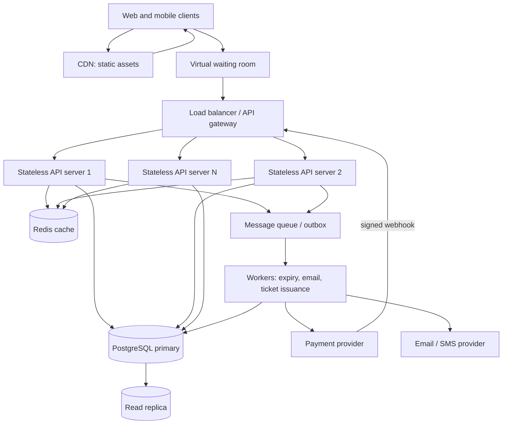

# TicketHub — Event Ticketing System Design

## 1. Requirements

### Context
TicketHub is a web platform for discovering concerts and events, selecting seats, reserving them, paying, and viewing purchased tickets. It has 2 million registered users. The design must support normal daily use and a sudden, highly contested concert sale.

### Functional requirements
1. Users can register, sign in, and view their account.
2. Users can browse, search, and view upcoming events.
3. Users can view a venue's seat map and the current availability of seats for an event.
4. A signed-in user can temporarily hold an available seat.
5. A user can pay for a valid reservation and receive a confirmed order/ticket.
6. Users can view their orders and tickets.
7. A hold expires automatically if payment is not completed before its expiry.
8. Organisers/admins can publish events and configure ticket inventory (administrative functions are outside the public API examples below).

### Non-functional requirements
- **Performance:** event pages should normally respond within 300 ms at the 95th percentile; seat-map availability should normally respond within 500 ms. During a major sale, requests should remain responsive or receive a clear queued/retry response rather than silently failing.
- **Correctness and consistency:** a seat must never be sold or actively held by two customers at once. Payment retries must not create duplicate orders or charges.
- **Fairness:** a virtual waiting room issues queue positions/tokens in arrival order for a sale. Users must not gain an advantage by repeatedly refreshing or opening many sessions. Apply per-account and per-token rate limits.
- **Availability:** browsing should remain available during a component failure where possible. Booking may be temporarily paused rather than risk incorrect inventory.
- **Security:** authenticate users; authorize access to their own orders; use HTTPS; validate inputs; protect payment data by using a PCI-compliant payment provider and tokenization; never store card numbers or CVVs.
- **Scalability:** stateless application servers can scale horizontally. The design must absorb short traffic spikes.
- **Durability and auditability:** confirmed orders and payment outcomes must be durably recorded; booking and payment state changes must be traceable.
- **Accessibility:** seat selection and checkout should be usable with keyboard and assistive technology.

## 2. Scale estimates

### Normal day
Given:
- 2,000,000 registered users.
- 50,000 daily visitors.
- Each visitor views 10 pages.
- 5,000 tickets sold per day.

Calculations:
- Page views/day = 50,000 × 10 = **500,000 page views/day**.
- Average page views/second over 24 hours = 500,000 ÷ 86,400 = **5.8 page views/second**.
- Average ticket sales/second = 5,000 ÷ 86,400 = **0.058 tickets/second** (about one every 17 seconds).

The averages hide busy periods. For capacity planning, assume normal peak traffic is 10 times the daily average: about **58 page views/second**. This is an explicit planning assumption, not a supplied fact. A production design would use measured traffic curves and load tests.

### Popular concert sale
Given 200,000 people attempt to buy 20,000 seats in 10 minutes:
- Buyer arrival rate = 200,000 ÷ 600 = **333 buyer attempts/second**.
- Demand-to-supply ratio = 200,000 ÷ 20,000 = **10:1**.
- Only 10% of the attempted buyers can obtain one of the 20,000 seats, assuming one seat per buyer and all seats are sellable.
- If each buyer generates an estimated 5 API calls (event/seat-map reads, hold, payment initiation, and order check), the system may see roughly **1,667 API requests/second** during the sale. This is a planning estimate; retries and polling can increase it.

### Comparison
The assumed sale request rate of about 1,667 requests/second is approximately **29 times** the assumed normal peak of 58 page views/second. The raw buyer arrival rate (333/second) is about 5.7 times the normal peak page-view rate. These figures are not perfectly like-for-like: one is an estimated all-API request rate and the other is page views. The comparison demonstrates why a sale needs admission control, caching, horizontal scaling, and careful protection of the database.

## 3. API design

All endpoints use HTTPS and JSON. Protected endpoints require a bearer access token. IDs are opaque identifiers. Example responses are abbreviated.

| Method and endpoint | Purpose | Success |
|---|---|---:|
| `GET /api/v1/events` | Browse/search events; supports `?q=` and pagination | 200 |
| `GET /api/v1/events/{eventId}` | View event details | 200 |
| `GET /api/v1/events/{eventId}/seats` | Read seat map and availability | 200 |
| `POST /api/v1/events/{eventId}/holds` | Atomically hold one or more seats for a short period | 201 |
| `POST /api/v1/orders/{orderId}/payment-intent` | Start payment for a valid held-seat order | 200 |
| `GET /api/v1/me/orders` | List the signed-in user's orders | 200 |
| `GET /api/v1/me/orders/{orderId}` | View one of the user's orders/tickets | 200 |

### Browse events
`GET /api/v1/events?query=jazz&limit=20`

Response `200`:
```json
{
  "items": [
    {
      "id": "evt_123",
      "name": "City Jazz Night",
      "startsAt": "2027-05-14T19:00:00Z",
      "venue": "Central Arena"
    }
  ],
  "nextCursor": null
}
```

### View seats
`GET /api/v1/events/evt_123/seats`

Response `200`:
```json
{
  "eventId": "evt_123",
  "seats": [
    {"id": "seat_A12", "label": "A12", "status": "AVAILABLE"},
    {"id": "seat_A13", "label": "A13", "status": "HELD"}
  ]
}
```
The seat map is a read model; its status can change immediately after it is returned. The hold endpoint is authoritative.

### Hold seats
`POST /api/v1/events/evt_123/holds`
Header: `Idempotency-Key: 8f2c...`

Request:
```json
{
  "seatIds": ["seat_A12"],
  "queueToken": "signed-sale-admission-token"
}
```

Response `201`:
```json
{
  "orderId": "ord_456",
  "status": "PENDING_PAYMENT",
  "expiresAt": "2027-05-14T18:05:00Z",
  "heldSeatIds": ["seat_A12"]
}
```
If the seat is no longer available, return `409 Conflict`. If the user's queue token is invalid or not yet admitted, return `403 Forbidden` or `429 Too Many Requests`, as appropriate.

### Start payment
`POST /api/v1/orders/ord_456/payment-intent`
Header: `Idempotency-Key: 91ab...`

Request:
```json
{"paymentMethodToken": "provider-token"}
```

Response `200`:
```json
{
  "orderId": "ord_456",
  "paymentStatus": "PROCESSING",
  "providerReference": "pay_789"
}
```
The payment provider calls a signed webhook to report the final result. The backend verifies the webhook and confirms the order only if the reservation is still valid under the booking rules. Repeated requests with the same idempotency key return the same logical result.

### View my tickets
`GET /api/v1/me/orders/ord_456`

Response `200`:
```json
{
  "orderId": "ord_456",
  "status": "CONFIRMED",
  "tickets": [
    {"ticketId": "tkt_321", "eventId": "evt_123", "seatLabel": "A12"}
  ]
}
```

### Common error responses
- `400 Bad Request`: invalid input.
- `401 Unauthorized`: missing/invalid login.
- `403 Forbidden`: user is not allowed to access the resource or queue admission is denied.
- `404 Not Found`: event, seat, or order does not exist.
- `409 Conflict`: seat is already held/sold or order state conflicts.
- `429 Too Many Requests`: rate limit reached.
- `500 Internal Server Error`: unexpected server error.
- `503 Service Unavailable`: booking temporarily paused or dependency unavailable.

Example:
```json
{
  "error": {
    "code": "SEAT_UNAVAILABLE",
    "message": "One or more selected seats are no longer available."
  }
}
```

## 4. Data model

The core relational model uses PostgreSQL because orders, users, events, seats, and reservations have clear relationships and require transactional consistency.

### Tables and relationships

- **users**: one user can create many orders (one-to-many).
- **events**: one event has many seats and many orders (one-to-many).
- **seats**: each seat belongs to one event; a seat row represents sellable inventory for that event. `(event_id, seat_label)` is unique.
- **orders**: each order belongs to one user, one event, and one seat in this simplified model. An order moves through `PENDING_PAYMENT`, `CONFIRMED`, `EXPIRED`, or `CANCELLED`.

A multi-seat basket can be modelled by adding an `order_items` table (one order to many seat items). The required four-table version below intentionally models one seat per order to keep the core concurrency rule clear.

### PostgreSQL schema

```sql
CREATE TABLE users (
    id BIGSERIAL PRIMARY KEY,
    email TEXT NOT NULL UNIQUE,
    full_name TEXT NOT NULL,
    created_at TIMESTAMPTZ NOT NULL DEFAULT now()
);

CREATE TABLE events (
    id BIGSERIAL PRIMARY KEY,
    name TEXT NOT NULL,
    venue_name TEXT NOT NULL,
    starts_at TIMESTAMPTZ NOT NULL,
    sales_open_at TIMESTAMPTZ,
    status TEXT NOT NULL CHECK (status IN ('DRAFT', 'ON_SALE', 'SOLD_OUT', 'CANCELLED'))
);

CREATE TABLE seats (
    id BIGSERIAL PRIMARY KEY,
    event_id BIGINT NOT NULL REFERENCES events(id),
    seat_label TEXT NOT NULL,
    price_cents INTEGER NOT NULL CHECK (price_cents >= 0),
    status TEXT NOT NULL DEFAULT 'AVAILABLE'
        CHECK (status IN ('AVAILABLE', 'HELD', 'SOLD')),
    held_by_user_id BIGINT REFERENCES users(id),
    hold_expires_at TIMESTAMPTZ,
    UNIQUE (event_id, seat_label),
    CHECK (
      (status = 'AVAILABLE' AND held_by_user_id IS NULL AND hold_expires_at IS NULL)
      OR
      (status = 'HELD' AND held_by_user_id IS NOT NULL AND hold_expires_at IS NOT NULL)
      OR
      (status = 'SOLD' AND held_by_user_id IS NOT NULL)
    )
);

CREATE TABLE orders (
    id BIGSERIAL PRIMARY KEY,
    user_id BIGINT NOT NULL REFERENCES users(id),
    seat_id BIGINT NOT NULL REFERENCES seats(id),
    status TEXT NOT NULL
        CHECK (status IN ('PENDING_PAYMENT', 'CONFIRMED', 'EXPIRED', 'CANCELLED')),
    idempotency_key TEXT NOT NULL UNIQUE,
    payment_reference TEXT UNIQUE,
    created_at TIMESTAMPTZ NOT NULL DEFAULT now(),
    updated_at TIMESTAMPTZ NOT NULL DEFAULT now()
);

-- A seat can have only one active or confirmed order.
CREATE UNIQUE INDEX one_live_order_per_seat
ON orders(seat_id)
WHERE status IN ('PENDING_PAYMENT', 'CONFIRMED');

CREATE INDEX events_starts_at_idx ON events(starts_at);
CREATE INDEX seats_event_status_idx ON seats(event_id, status);
CREATE INDEX orders_user_created_idx ON orders(user_id, created_at DESC);
```

The seat row is the authoritative inventory record. The unique partial index is a second line of defence against multiple live orders for one seat. A background worker expires overdue holds and releases the seat in a transaction. In production, state transitions must be coordinated so that an expired order cannot be confirmed later by a delayed payment callback.

## 5. Preventing double booking

A seat-map response is only a snapshot. Two customers may both see A12 as available, so the backend must arbitrate the claim in the database.

The hold operation uses a short transaction and a conditional update:

```sql
BEGIN;

UPDATE seats
SET status = 'HELD',
    held_by_user_id = :user_id,
    hold_expires_at = now() + interval '5 minutes'
WHERE id = :seat_id
  AND status = 'AVAILABLE'
RETURNING id, event_id, seat_label, hold_expires_at;

-- Continue only if exactly one row was returned.
-- Insert the PENDING_PAYMENT order in the same transaction.
INSERT INTO orders (user_id, seat_id, status, idempotency_key)
VALUES (:user_id, :seat_id, 'PENDING_PAYMENT', :idempotency_key);

COMMIT;
```

If the conditional update returns no row, another customer has already held or bought the seat; return `409 Conflict`. If order insertion fails, the transaction rolls back the seat update. PostgreSQL row locking/transaction isolation serializes competing updates to the same seat row. The unique `(event_id, seat_label)` constraint prevents duplicate inventory rows, while the partial unique index prevents more than one pending/confirmed order for a seat.

For expired holds, a worker must atomically mark the pending order `EXPIRED` and release the seat only when `hold_expires_at < now()`. Payment webhooks must be idempotent and re-check the order/seat state before confirmation. If payment succeeds after a hold has expired and the seat has been reallocated, the system must not confirm the second booking; it should trigger a refund/void workflow.

This design provides correctness at the database boundary. Redis locks alone are not the source of truth.

## 6. Architecture



### Component responsibilities
- **Web/mobile clients:** render event pages, seat maps, checkout and tickets.
- **CDN:** serves static JavaScript, CSS, images and other cacheable content close to users. It does not decide whether a seat is available.
- **Virtual waiting room:** admits a controlled number of users using signed queue tokens and a fair queue policy. It reduces the chance that all 200,000 visitors hit the booking API at once.
- **Load balancer/API gateway:** distributes requests across healthy API servers, terminates TLS, applies authentication and rate limits.
- **Stateless API servers:** implement event, seat, hold, order and payment endpoints. Multiple instances allow horizontal scaling.
- **Redis:** caches public event details and non-authoritative seat-map snapshots, and may hold queue/session data. A cache miss falls back to the database. Seat claims always go to PostgreSQL.
- **PostgreSQL primary:** authoritative store for inventory, holds, orders and payment state. Transactions and constraints enforce booking correctness.
- **Read replica:** serves suitable read-heavy queries such as event browsing. Replication can lag, so it must not be used to decide whether a seat can be claimed.
- **Message queue/outbox and workers:** handle hold expiry, ticket generation, email/SMS and retryable background work. An outbox record written in the same database transaction prevents losing an event between database commit and queue publication.
- **Payment provider:** securely processes payment details. Signed webhooks communicate final payment status.
- **Monitoring/alerts:** observe latency, error rates, queue depth, database connections, lock waits, hold expiry and payment failures.

### Big-sale request flow
1. CDN serves static content. Event details and seat-map snapshots are cached where safe.
2. Visitors enter the waiting room. The admission controller releases users at a rate the backend and database can handle, using a transparent queue policy.
3. The load balancer distributes admitted API requests across horizontally scaled stateless servers.
4. Browsing reads are served from Redis or a read replica when appropriate.
5. A seat hold is sent to the primary database. The conditional update and transaction decide the winner.
6. Payment is initiated with an idempotency key. The signed provider webhook updates the order state.
7. Workers issue tickets and send notifications asynchronously.

If the primary database is unhealthy, TicketHub pauses new reservations rather than returning potentially incorrect availability. Browsing may continue from cached/read-replica data with a visible “availability may be delayed” message.

## 7. Trade-offs

### Trade-off 1: Strict database consistency vs maximum booking throughput
Sending every seat claim to the PostgreSQL primary adds contention and can limit throughput during a sale. However, it gives one authoritative decision and prevents double booking. Correctness is more important than accepting every simultaneous request. Mitigations include a waiting room, short transactions, appropriate indexes, connection pooling, and load testing. I would not use eventually consistent cache writes to allocate seats.

### Trade-off 2: Fair virtual queue vs fastest possible access
A waiting room adds a step and may make some users wait even when the site appears available. It also needs protection against bots and multiple sessions. However, controlled admission protects the booking service and provides a more predictable, auditable sale process. Queue rules should be published and consistently applied.

### Trade-off 3: Cache speed vs freshness
Caching event pages and seat maps reduces database reads and improves response times. But cached seat availability can become stale during a sale. Therefore, cached seat maps are informational only; every hold is validated atomically against the primary database. This preserves speed for browsing without compromising booking correctness.

### Trade-off 4: Synchronous checkout vs asynchronous payment confirmation
Waiting for every downstream action synchronously makes checkout slower and fragile. Asynchronous payment webhooks and workers improve resilience, but users may briefly see `PROCESSING`. Idempotency keys, signed webhooks, retries and reconciliation are required to avoid duplicate charges or inconsistent order states.

## Assumptions and open questions
- The normal peak multiplier of 10× and five API calls per sale buyer are planning assumptions, not measured facts.
- The simplified schema models one seat per order. A real group purchase should add `order_items` and enforce uniqueness per seat across active/confirmed items.
- Product decisions still needed: hold duration, queue policy, cancellation/refund rules, event organiser permissions, and whether general-admission tickets (without assigned seats) are supported.
